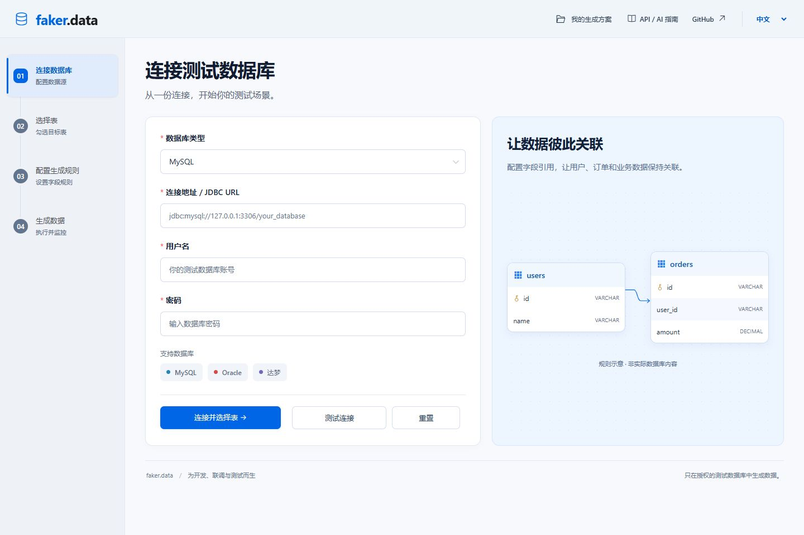
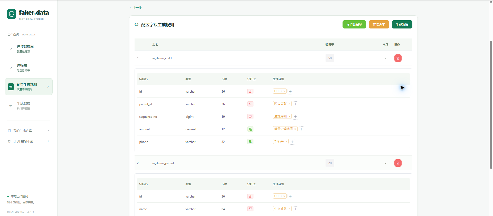
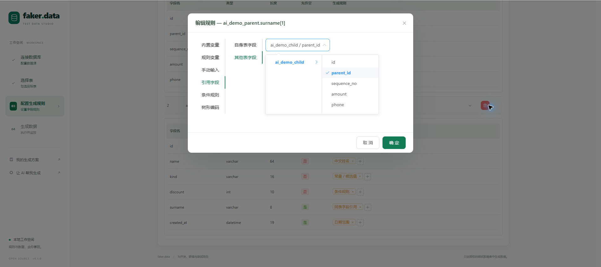
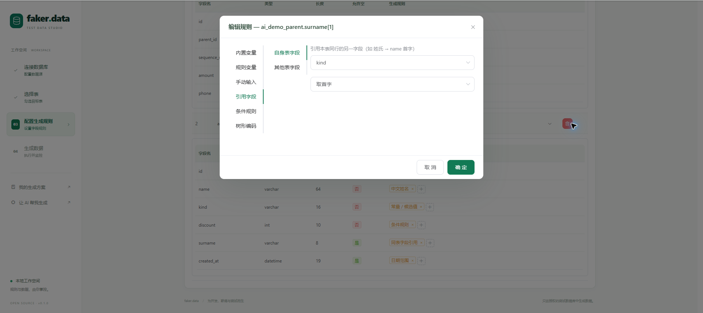

# faker-data · 测试数据，不止随机

当前源码新增：[AI MCP 接入](docs/mcp.md)、按条件精确引用，以及通用[订单示例](examples/create-order-schemes.py)。旧版已发布 JAR 不包含这些改动。


> **访问地址：** v0.1.1 与当前源码使用 `http://127.0.0.1:8085/`，不再需要 `/faker`。旧版 v0.1.0 JAR 仍使用 `http://127.0.0.1:8085/faker/`。版本差异见[访问地址说明](docs/access-url.md)。

[English](README.md) · **简体中文** · [下载可执行版](https://github.com/yanjiajun0604-commits/faker-data/releases/latest) · [AI 调用指南](AI_USAGE.md)

**用一个 JAR，把空表变成可测试的业务场景。**

给用户表生成人名和手机号很容易；让订单引用正确的用户，让组织形成一棵树，让不同类型的用户享有不同折扣，才是真正的测试场景。faker-data 把这些关系和规则放进一个本地可视化工作台，也让 AI 能通过 HTTP 接口完成同样的流程。



### 你可以用它做什么？

| 你的任务 | faker-data 如何帮你 |
| --- | --- |
| 接口联调、功能测试、页面演示 | 为已有测试表批量生成数据，按字段定义规则 |
| 用户和订单等父子表场景 | 同一任务内生成父表，并让子表引用本次生成的父行 |
| 部门、菜单、组织等层级场景 | 控制根数、层数、分叉及结构编码，生成父子关联 |
| 会员折扣、条件标签等业务差异 | 使用条件规则与同表字段引用，让值之间有逻辑 |
| 反复使用同一套配置 | 本地保存生成方案，下次载入后调整再执行 |
| 用自然语言驱动测试数据生成 | 让本地 AI 阅读调用指南，再通过接口配置和执行 |

**不写生成脚本也能开始。** 启动当前源码构建的 JAR 后，打开 `http://127.0.0.1:8085/`；已经发布的 v0.1.0 JAR 使用旧地址 `http://127.0.0.1:8085/faker/`。应用无需另装 MySQL、Redis 或 Node.js；真正写入数据仍需你自己的目标测试数据库。


界面右上角可切换 **中文 / English**。默认跟随浏览器语言，手动选择会记住；切换时保留当前连接、规则和任务。日期选择器、分页、弹窗及校验提示同步切换。内置姓名、身份证号和手机号仍为中国格式，语言切换不改变数据规则。

### 看看规则编辑器

<details>
<summary>展开查看字段规则、跨表引用和同表引用截图</summary>







截图展示编辑功能，不代表推荐字段映射。可运行配置请以已验证的 JSON 示例为准，避免构造循环表依赖。

</details>

### 选择适合你的版本

- **只想使用工具：** 在 [Releases](https://github.com/yanjiajun0604-commits/faker-data/releases) 下载可执行 JAR，无需编译前端或后端。
- **希望查看或修改代码：** 本仓库包含 Java 后端、Vue 前端、测试、构建脚本和 MIT 许可证。
- **希望让 AI 操作：** 阅读 [AI_USAGE.md](AI_USAGE.md)，使用附带 JSON 示例和零第三方依赖的 Python 客户端。

[通用单据配置示例](docs/document-recipes.md) 演示精确状态数量、共享主键和主子表关联，全部使用现有规则。示例状态不代表已创建可运行的工作流实例。 当前源码还新增[已有数据引用与父记录展开](docs/existing-data.md)，通过 JSON 配置使用。

当前源码支持默认关闭的[字段级本地扩展](docs/local-extensions.md)：普通字段使用现有规则，仅复杂字段调用可信本地代码。方案沿用“使用”入口及字段编辑器，可通过 [stdio MCP 适配器](docs/mcp.md) 调用同一引擎，仍需针对目标系统验收。

## 快速开始

准备 Java 8 JDK（本版本已验证）和网络连接，克隆后运行：

```powershell
.\run.cmd
```

macOS / Linux：

```sh
chmod +x mvnw run.sh
./run.sh
```

首次启动脚本使用 Maven Wrapper 下载公开构建依赖并打包；完成后打开 **http://127.0.0.1:8085/**。后续启动复用已生成的 JAR。也可直接下载 v0.1.1 JAR 运行，旧版 v0.1.0 仍需访问 `/faker/`：

```sh
java -jar faker-data-0.1.1.jar
```

端口占用时，无需编辑配置文件：

```powershell
$env:SERVER_PORT = '8095'
.\run.cmd
```

在页面填写目标数据库地址、账号、密码，测试连接，选择表和字段规则，再提交生成任务。SQLite 只保存应用自己的方案及任务记录，**不是新增的生成目标数据库类型**。

## 本地数据与任务

- 数据默认放在工作目录的 `data/faker-data.db`；启动脚本会切换到项目目录。通过 `FAKER_DATA_DIR` 指定其他目录。
- 同名方案更新时保留 ID 和创建时间；方案、任务状态在重启后保留。
- 默认 2 个工作线程、100 个排队位置，队列满时拒绝新任务。只在整个目标事务提交成功后显示 100%。
- 排队或执行中的任务遇到进程退出，下一次启动标为失败；不会自动重放写入。请先核对目标数据库数据再重新提交。
- 同一数据目录只允许运行一个实例。任务队列是单进程队列；Redis 模式也不提供多实例任务调度。
- SQLite 使用 WAL 和 30 秒锁等待，任务进度按生成批次更新。SQLite 单写者机制不参与逐行生成。

## 内存缓存和可选 Redis

默认 `memory` 模式把跨表引用值存入进程内存，省去网络往返。任务成功或失败后只清理本任务缓存。

内存缓存默认上限是 **500,000 项、估算 128 MiB**，取先到者；超过时明确失败并回滚目标事务，不会淘汰仍被引用的数据。估算只约束引用缓存，不是 JVM 总内存限制；行 ID、树状态、驱动缓冲及其他对象也会占内存。大任务可减小单次生成量、调整上限，或选 Redis 分担引用值存储。

```powershell
$env:FAKER_CACHE_BACKEND = 'redis'
$env:FAKER_REDIS_HOST = '127.0.0.1'
$env:FAKER_REDIS_PORT = '6379'
$env:FAKER_REDIS_DATABASE = '0'
# 有密码时设置 FAKER_REDIS_PASSWORD
.\run.cmd
```

Redis 模式启动时检查连接；每任务一个 `faker:reference:<taskId>` 哈希，写入刷新 18 小时过期时间，任务结束主动删除。不会清空数据库或扫描删除其他应用的键。默认内存模式不创建 Redis 连接。

| 环境变量 | 默认值 | 含义 |
| --- | --- | --- |
| `SERVER_PORT` | `8085` | HTTP 端口 |
| `SERVER_ADDRESS` | `127.0.0.1` | 监听地址 |
| `FAKER_DATA_DIR` | `./data` | SQLite 及实例锁目录 |
| `FAKER_TASK_WORKERS` | `2` | 同时执行任务数 |
| `FAKER_TASK_QUEUE_CAPACITY` | `100` | 等待队列容量 |
| `FAKER_CACHE_BACKEND` | `memory` | `memory` 或 `redis` |
| `FAKER_CACHE_MAX_ENTRIES` | `500000` | 内存引用条目上限 |
| `FAKER_CACHE_MAX_BYTES` | `134217728` | 内存引用容量估算上限 |

## 构建与开发

所有 Maven 依赖来自公开仓库；原来的 `pers.bbs` 私有快照依赖已移除，必要任务接口和响应对象已包含在源码中。达梦驱动使用公开 Maven 坐标。无需用户自己的 Maven 私服或本机 `bbs` 工程。

```powershell
.\mvnw.cmd test
.\mvnw.cmd package
java -jar target/faker-data-0.1.1.jar
```

前端源代码位于 `frontend/`，已构建的静态文件位于 `src/main/resources/static/`。仅修改后端时不需要 Node.js；修改前端时使用 Node.js/npm：

```powershell
cd frontend
npm ci
npm run build
cd ..
.\mvnw.cmd package
```

开发前端可运行 `npm run serve`，本地代理默认访问后端 8085 端口；通过 `FAKER_BACKEND_URL` 覆盖代理目标。打包后的 API 使用同源根路径 `/`，修改服务端口不需要重建前端。修改源码后需手动重新打包，启动脚本不会自动检查 JAR 是否过期。

## 可复现验证

普通 `mvnw test` 不连接外部 MySQL、Oracle、达梦或 Redis。包含原有规则测试，以及 SQLite 方案保存、任务排队/容量、失败处理、缓存隔离/清理、真实生成引擎在 H2 测试数据库上的跨表引用及事务回滚验证。H2 仅是测试依赖，不是产品支持的目标类型。

需要独立测试 Redis 时，显式指定端口：

```powershell
.\mvnw.cmd -Dfaker.redis.test.port=16389 -Dtest=RedisReferenceCacheTest test
```

该测试只操作随机任务键，不执行 FLUSHDB。包含缓存读写微基准；它不代表完整生成吞吐率。MySQL、Oracle、达梦的实际版本兼容和完整业务验收，需要连接各自的独立测试库。

- [SpEL 内置函数说明](docs/spel-functions-guide.md)
- [树形数据查询示例](docs/tree_visualize.sql)
- [架构变更与使用说明](docs/portable-design.md)

## 使用边界与许可证

本工具向目标数据库实际写入数据，适用于授权的测试环境。接口没有用户认证，默认只监听本机；不要直接向公网开放。保存方案时会保存填写的数据源信息（包括密码），请保护 `data/`，不要提交或共享自己的数据库文件。任务记录不保存带凭据的任务请求。

项目自有代码采用 [MIT 许可证](LICENSE)，包括经作者授权迁入的任务接口及响应对象。无需申请许可证账号或等待审批，仓库中的许可文件即授予相应使用、修改和分发权限。第三方依赖仍遵循各自的许可，见 [第三方说明](THIRD_PARTY_NOTICES.md)。
